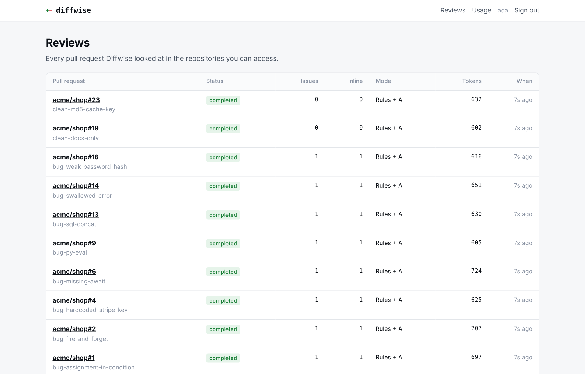
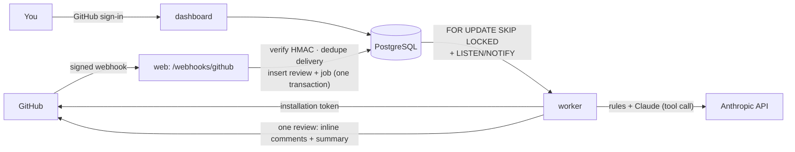
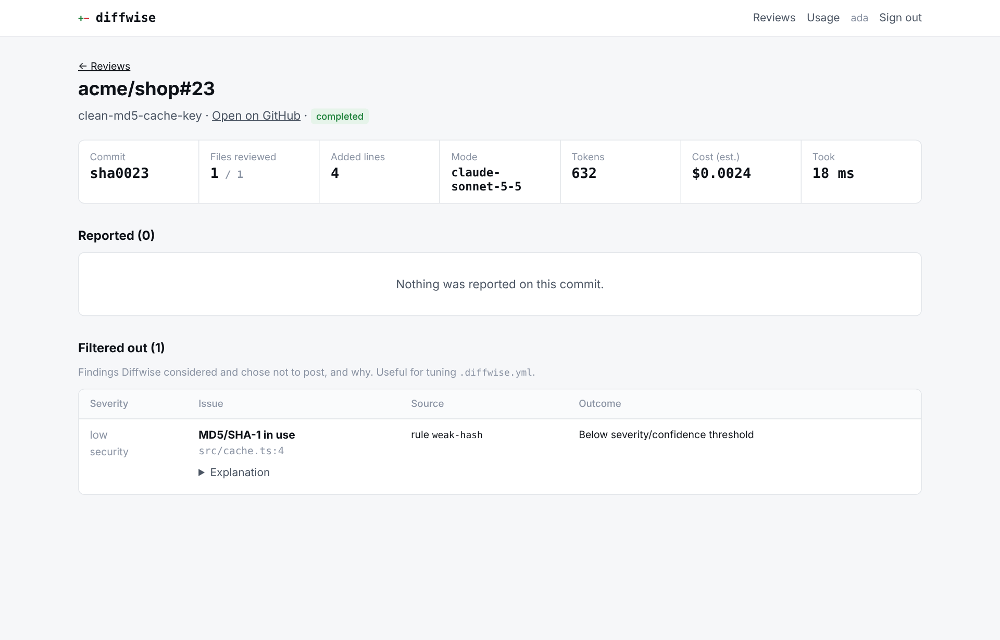
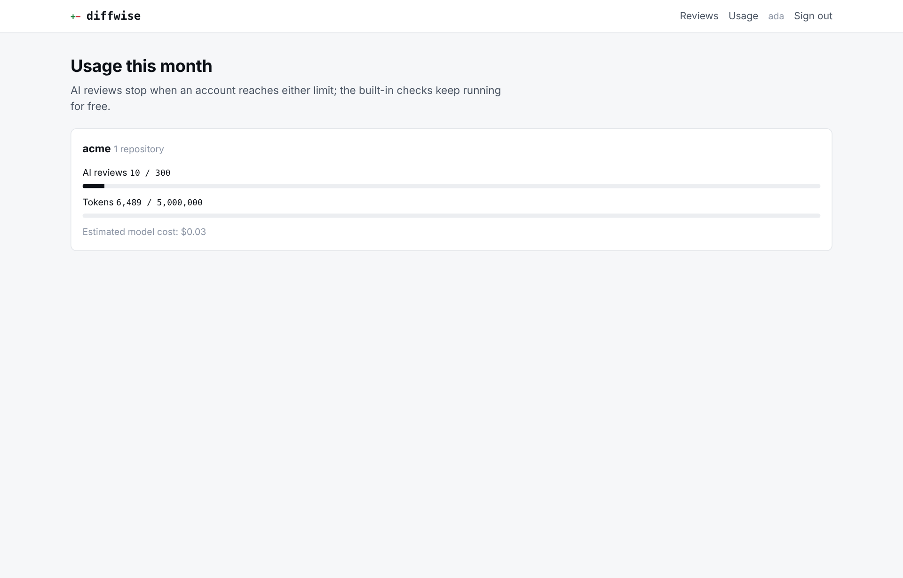

# Diffwise

An AI pull-request reviewer that comments on the exact lines that changed, and an evaluation suite that measures how often it's right.

Diffwise is a GitHub App. When a pull request is opened or updated, it reviews the diff with built-in checks and Claude, then posts a single review: inline comments on added lines (with one-click suggested fixes) and a short summary. It stays quiet when there's nothing worth saying.



## Why it's not just "send the diff to a model"

Most AI reviewers lose developers' trust within a week because they're noisy. Diffwise is designed around avoiding that:

| Problem with naive AI review | What Diffwise does |
| --- | --- |
| Comments on lines that don't exist or weren't changed | Every model finding must cite a line the PR **added**; anything else is dropped as unanchored. The prompt numbers each line explicitly. |
| Free-text output that's hard to trust or parse | The model must call a `report_findings` tool with a JSON schema (path, line, severity, category, confidence, optional one-line fix). Output is validated; malformed findings are discarded. |
| Style nitpicks and "consider adding tests" | The system prompt sets a high bar (concrete defect + plausible failure). Style and maintainability are off by default. Severity and confidence thresholds are configurable. |
| The same comment on every push | Findings are fingerprinted by *code content*, not line number, so an issue that moves when lines shift is still recognised and not reposted. |
| Misses the boring-but-critical stuff | Deterministic rules run on every line regardless of the model: leaked secrets and private keys, SQL built from strings, disabled TLS verification, `eval`, raw-HTML injection, weak password hashing, swallowed errors, stray `debugger`. Rules win ties with the model. |
| Prompt injection via code or PR text | Diff and title are marked as untrusted data. Model text is escaped before posting, and `@mentions` are neutralised. |
| A PR can turn its own review off | `.diffwise.yml` is read from the **base** branch, not the PR. |
| Unbounded cost | Per-installation monthly limits on AI reviews and tokens. Over the limit, the free rule checks keep running. PRs over 3,000 changed lines are skipped with an explanation. |

Here is a real comment as posted on a PR:

````markdown
**🟠 High · Bug** — findById returns a Promise here, so the 404 branch can never run

`users.findById` is async but isn't awaited, so `user` is always a pending Promise (truthy). Missing users fall through to `user.name` and return `{}` instead of a 404.

```suggestion
  const user = await users.findById(id)
```

<sub>Diffwise · 91% confidence</sub>
````

## Measuring it: the evaluation suite

`eval/` holds 27 labelled pull requests: 17 with real bugs across TypeScript, JavaScript, Python, Go and Java, and 10 clean PRs that contain traps that naive checkers flag. The traps include parameterised SQL, `password: process.env.DB_PASSWORD`, `"Select a " + kind`, MD5 used for a cache key, safe `textContent` DOM updates, and test fixtures. Each expected issue is anchored to the code it sits on, not a line number, so cases can't silently go stale.

```bash
npm run eval                                              # built-in rules only (free)
ANTHROPIC_API_KEY=… npm run eval -- --provider anthropic --record   # the model, recorded
npm run eval -- --provider replay --recording eval/recordings/<file>.json   # free, deterministic
```

It reports:

- **precision**: are the reported issues real?
- **recall**: were the real issues reported?
- **clean-PR noise**: how many clean PRs got any comment at all?
- **duplicates**: a second comment about a real issue counts as noise, not as an invented issue.

**Baseline with the built-in rules only:**

| Metric | Rules only |
| --- | --- |
| Precision | **100%** (8 of 8 comments were real issues) |
| Recall | 47% (8 of 17) |
| Clean PRs with any comment | **0%** (0 of 10) |

The rules catch every security bug in the set and never fire on the traps. The 9 they miss are logic bugs: off-by-one, missing `await`, race conditions, async `forEach`, a pagination offset, a mutable default argument, `=` instead of `==`, a resource leak, and an ignored error. Finding those is the model's job. Run the eval with your key to measure your model and prompt, then commit the recording. CI replays it on every push and fails the build if precision, recall or clean-PR noise regress.

## How it works



1. **Webhook.** The signature is checked against the raw body in constant time. The delivery ID is stored so GitHub's redeliveries are no-ops. In the same transaction, a review row and a job are created.
2. **Queue.** It's a PostgreSQL job queue: `SKIP LOCKED` claims, leases that are reaped if a worker dies, exponential backoff with jitter, and a dead-letter state. Dedupe keys make enqueueing idempotent, and group keys let a new push **supersede** queued reviews of older commits. Reviews are debounced (20s by default), so a burst of pushes produces one review.
3. **Review.**
   - Fetch the PR and its files, and read the config from the base branch.
   - Drop lock files, generated code and anything ignored by the config.
   - Run the rules, then batch the remaining diff into prompts under a size budget and call Claude in parallel.
   - Validate and anchor the findings, apply thresholds, de-duplicate against earlier commits, rank, then post the review.
4. **Failure handling.**
   - GitHub 5xx and rate limits retry, while 4xx errors fail fast.
   - Model overloads retry inside the call, then at the job level. On the final attempt, Diffwise posts the rule findings and says the AI review was unavailable.
   - If GitHub rejects inline positions (422), the findings move into the summary.
   - The GitHub review ID is saved as soon as it's posted, so a retry never double-posts.

## Configuration per repository

Add `.diffwise.yml` to the default branch:

```yaml
min_severity: medium        # low | medium | high | critical
min_confidence: 0.7         # model findings below this aren't posted
max_comments: 10            # the rest go in the summary
categories:                 # bug, security, performance, reliability on by default
  maintainability: true
  style: false
rules:
  console-log: true         # off by default
ignore:
  - "migrations/**"
  - "**/*.generated.ts"
review_drafts: false
instructions: |
  Money is always integer cents. We never throw in request handlers; we return Result.
```

An invalid file never blocks a review. Diffwise uses the defaults and says why in the summary. Comment `/diffwise review` on a PR to re-run, for example after changing the config or on a draft. Only collaborators can trigger it.

## The dashboard

Sign in with GitHub to see reviews for the installations you can access (checked against GitHub on every sign-in). Each review shows what was posted and **what was filtered out and why**, which makes tuning thresholds concrete. There's also a usage view with per-account limits and estimated model cost.

| Review detail | Usage |
| --- | --- |
|  |  |

## Running it

### 1. Create the GitHub App

Go to **Settings → Developer settings → GitHub Apps → New GitHub App** (or register it from [`app-manifest.json`](app-manifest.json)) and set:

- **Webhook URL:** `https://YOUR-DOMAIN/webhooks/github`, plus a random webhook secret.
- **Callback URL:** `https://YOUR-DOMAIN/auth/callback`
- **Permissions:**
  - Pull requests: read & write
  - Issues: read & write (for comments)
  - Contents: read-only
  - Metadata: read-only
- **Events:** Pull request, Issue comment, Installation repositories.
- Generate a private key and note the App ID, client ID and client secret.

For local development, expose port 3000 with a tunnel (e.g. `cloudflared` or `ngrok`) and use that URL.

### 2. Start it

```bash
cp .env.example .env   # fill in the GitHub App values, SESSION_SECRET and (optionally) ANTHROPIC_API_KEY
docker compose up -d --build
```

Or without Docker (Node 22 and PostgreSQL 14+):

```bash
npm install
npm run migrate
npm run dev:web      # http://localhost:3000
npm run dev:worker
```

Install the app on a repository and open a pull request.

### Try it without GitHub

The same engine runs against your local changes:

```bash
npm run review:local -- --base main      # exits 1 if it finds high or critical issues
```

### Environment

| Variable | Default | Purpose |
| --- | --- | --- |
| `DATABASE_URL` | required | PostgreSQL |
| `SESSION_SECRET` | required | Signs dashboard session cookies (32+ chars) |
| `PUBLIC_URL` | `http://localhost:3000` | Used for OAuth redirects and the CSRF origin check |
| `GITHUB_APP_ID`, `GITHUB_PRIVATE_KEY`, `GITHUB_WEBHOOK_SECRET` | required | From the GitHub App |
| `GITHUB_CLIENT_ID`, `GITHUB_CLIENT_SECRET` | — | Dashboard sign-in |
| `GITHUB_APP_SLUG` | `diffwise` | For the install link |
| `ANTHROPIC_API_KEY` | — | Enables AI review; without it, built-in rules only |
| `LLM_MODEL` | `claude-sonnet-5-5` | Model used for reviews |
| `LLM_INPUT_PRICE_PER_MTOK`, `LLM_OUTPUT_PRICE_PER_MTOK` | `3`, `15` | Only for cost estimates; set to your model's prices |
| `DEFAULT_MONTHLY_REVIEW_LIMIT` / `DEFAULT_MONTHLY_TOKEN_LIMIT` | `300` / `5000000` | Per-installation AI budget |
| `MAX_PR_CHANGED_LINES` | `3000` | Larger PRs are skipped unless `/diffwise review` is used |
| `REVIEW_DEBOUNCE_SECONDS` | `20` | Collapse rapid pushes into one review |
| `WORKER_CONCURRENCY` | `4` | Reviews per worker process |
| `BOT_COMMAND` | `/diffwise` | Comment prefix for manual re-runs |

## Tests

```bash
npm test     # needs PostgreSQL (TEST_DATABASE_URL)
```

There are 99 tests. Integration tests run against real PostgreSQL, plus an in-process **fake GitHub** and **fake Anthropic API**. The fake GitHub verifies the app's RS256 JWTs with the public key and rejects comments on lines outside the diff, like GitHub does. The fake Anthropic API checks headers and the forced tool call, and can simulate overloads. Coverage includes:

- the full webhook → queue → review → posted-comment flow
- redelivered webhooks, push bursts and superseding
- line shifts across commits (no reposting)
- the slash command and its permission check
- config read from the base branch, and broken config
- model overloads and graceful degradation, GitHub outages without double-posting, 422 fallback
- large PRs and monthly budgets
- queue concurrency, leases and dead-lettering
- the OAuth flow, access isolation between accounts, XSS escaping and CSRF
- every rule's true and false positives
- eval scoring, plus record and replay

CI runs typechecking, the tests, the eval gates and the Docker build.

## Tech

TypeScript, Node 22, Fastify 5, PostgreSQL (queue included), Anthropic Messages API with tool use, Zod, picomatch, yaml, pino, Vitest, Docker, GitHub Actions.

## Licence

MIT
